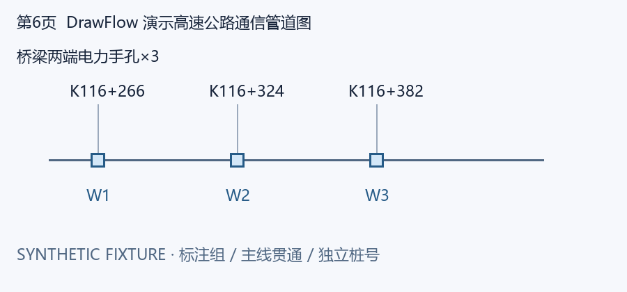
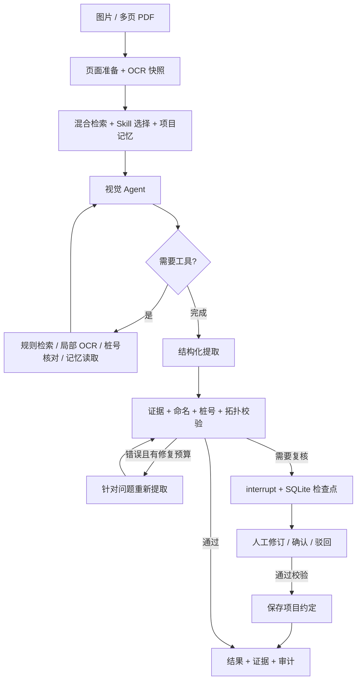

<div align="center">

# DrawFlow Agent

### 把通信施工图转化为可追溯的结构化资产数据

**LangChain · LangGraph · LangSmith · Qdrant · Hybrid RAG · Human-in-the-loop**

</div>

DrawFlow 面向高速公路通信管道平面图，识别人孔、手孔、接头管箱及关联设备，将名称、桩号、连通类型和位置属性整理为 **16 字段 JSON**。每条记录同时保留 OCR 引用、视觉观察、规则出处和复核记录，串起从图纸理解到结果交付的完整链路。

项目从 OCR、视觉提取与工具复核的实践代码演进而来，围绕三个问题组织工程设计：**如何选取识别规则、如何核对模型结果、如何让复核经验服务下一次任务。**

[快速运行](#快速运行) · [工作流](#工作流) · [技术实现](#技术实现) · [接入图纸](#接入自己的图纸) · [评估](#评估与测试) · [设计文档](docs/architecture.md)

## 先看一次运行

仓库附带一张自行构造的通信管道图、OCR sidecar 和标准输出。演示驱动会走完整的图节点，实际执行 Qdrant 检索、工具调用、证据校验、修复和文件导出。



```console
python -m drawflow demo --simulate-error

prepare → retrieve → agent → tools → agent → extract
        → validate → repair → validate → export

status: completed
records: 3
主线桩号: K116+266 / K116+324 / K116+382
```

这里的 `demo` 使用确定性决策驱动，`run` 使用配置的视觉模型。两种入口共享同一张 LangGraph、工具注册表、Qdrant 索引和证据校验器。

## 快速运行

Python **3.11+**。在仓库根目录执行：

```powershell
python -m venv .venv
.\.venv\Scripts\Activate.ps1
python -m pip install -e ".[dev,api]"
python -m drawflow ingest
python -m drawflow demo --simulate-error
```

Linux/macOS 激活命令为 `source .venv/bin/activate`。也可用虚拟环境中的 Python 直接执行命令。

每次运行自动生成 `run_id`，结果写入 `outputs/<run-id>/`：

```text
results.json       16 字段业务结果
evidence.json     页面、OCR 快照、视觉观察与字段引用
audit.json        检索引用、Skill 版本、工具耗时、修复次数及提示词摘要
run.json          任务状态、输出位置与检查点路径
pages/            PDF 页面、整图与重叠切片
```

查看规则检索与已注册 Skill：

```powershell
python -m drawflow search "沿主线连接两个邻井，怎样判断直通与分歧"
python -m drawflow skills
```

## 工作流



Agent 根据当前图像、OCR 和工具结果选择下一步。程序独立控制工具总次数、推理轮数和修复次数；同一轮的多个工具请求逐项计入预算。每个工具调用都有对应的 ToolMessage，失败信息也会返回给 Agent。

## 技术实现

| 能力 | 实现 | 在任务中的作用 |
|---|---|---|
| LangChain Agent | `ChatOpenAI.bind_tools`、消息历史、结构化输出 | 视觉判断、动态选择工具、提交类型化结果 |
| LangGraph | StateGraph、条件路由、SQLite checkpointer、interrupt | 工具循环、有限修复、人工复核与恢复 |
| LangSmith | 原生模型/图追踪、工具 trace、检索与入库 span | 关联节点耗时、输入输出和任务 ID |
| Chunk 策略 | Markdown 标题层级 → 1,800 字符父块 → 420 字符子块，重叠 80 | 用小块匹配问题，用父块还原完整规则 |
| Embedding | LangChain Embeddings 接口；本地字符 n-gram hash / OpenAI 兼容 API | 向量检索；按模型指纹与文本摘要缓存向量 |
| Vector Database | Qdrant Local / Qdrant Server | 持久化向量、来源与标题元数据 |
| Hybrid RAG | 向量召回 + 字符 n-gram 词项排序 + RRF + 父块去重 | 同时匹配桩号术语、中文规则和语义表达 |
| Skill | 带版本与触发条件的 `SKILL.md` | 按任务加载桩号核对、拓扑复核和表格解析步骤 |
| Memory | 任务级检查点 + 项目级 SQLite 长期记忆 | 恢复当前任务，复用已确认的命名约定与复核策略 |
| Tool | 五个带类型 Schema、绑定任务上下文的工具 | 模型选择规则检索、局部 OCR、桩号核对和记忆读取 |
| Prompt | 角色、工具策略和输出契约分文件管理 | 提示词可版本化，每次运行记录 SHA-256 |
| 服务与交付 | FastAPI、Dockerfile、GitHub Actions | HTTP 接入、部署打包与自动回归 |

### RAG：检索规则，关联来源

```text
Markdown 领域知识
  → 按标题建立父段落
  → 递归切分子块
  → Embedding + SQLite 缓存
  → Qdrant 持久化
  → Dense / Lexical 两路排序
  → RRF 融合与父块去重
  → 带 source、heading、content_hash 的规则上下文
```

索引记录模型指纹；更换 Embedding 模型或端点后执行 `ingest`，向量维度变化时使用新的 collection。重建采用稳定 ID upsert，随后移除失效块。自定义规则可以直接入库：

```powershell
python -m drawflow ingest --directory path/to/knowledge
```

内置 `hash` 后端使用 384 维字符 n-gram 特征，适合本地演示及领域术语检索。切换 `EMBEDDING_BACKEND=openai` 后使用配置的语义 Embedding API。父块保留来源，图纸字段则引用当前页的 OCR 与视觉观察。

### Memory：任务状态与项目经验

- **短期状态**：消息、页面、OCR、候选对象、工具预算和待复核问题随 LangGraph 检查点保存。
- **长期记忆**：人工通过复核后，显式提交命名约定或复核策略；每条记忆记录项目、来源任务、复核人和更新时间。
- **使用范围**：按 `project` 隔离；记忆作为识别约定加入上下文，具体桩号留在当前图纸证据中。

### Tools 与 Skills

| 工具 | 返回内容 |
|---|---|
| `search_knowledge` | 规则片段、父段落、引用和排序分数 |
| `ocr_region` | 当前任务指定页区域的 OCR 与原图坐标 |
| `validate_chainage` | 桩号格式与当前页支持它的 OCR 行 |
| `recall_project_memory` | 当前项目已确认的约定与策略 |
| `load_skill` | 已注册 Skill 的版本和操作步骤 |

Skills 目录中的三个 playbook 对应桩号核对、局部分歧判断和一标多井表格解析。它们在检索阶段按触发词加载，也可以由 Agent 通过工具主动选择。

## 人工复核与恢复

用一个新运行 ID 演示“暂停 → 修订 → 恢复 → 记忆写入”：

```powershell
python -m drawflow demo --run-id portfolio-review --project highway-a --force-review
python -m drawflow resume --run-id portfolio-review --decision examples/review.json
python -m drawflow memory --project highway-a
```

第一步返回退出码 `2`，将复核请求写入输出目录。第二步读取检查点、应用字段修订并重新校验证据；确认后的命名约定写入 `highway-a` 的长期记忆。运行 ID 标识一项任务，重复演示时换用新的 ID。

复核文件格式见 [examples/review.json](examples/review.json)。驳回任务可使用 [examples/reject.json](examples/reject.json)。

## 接入自己的图纸

复制 `.env.example` 为 `.env`，填写：

```dotenv
OPENAI_API_KEY=你的模型密钥
OPENAI_BASE_URL=你的OpenAI兼容端点
VISION_MODEL=支持图像及工具调用的模型ID
STRUCTURED_METHOD=function_calling
OCR_ENDPOINT=http://127.0.0.1:8008/ocr

EMBEDDING_BACKEND=openai
EMBEDDING_API_KEY=你的Embedding密钥
EMBEDDING_BASE_URL=你的Embedding端点
EMBEDDING_MODEL=text-embedding-3-small
```

按 [部署说明](docs/deployment.md) 启动 PaddleOCR 适配器，再执行：

```powershell
python -m drawflow ingest
python -m drawflow run --input path/to/drawing.pdf --project highway-a
```

已有 OCR 可传入 `--ocr-json path/to/ocr.json`。PNG、JPG、WebP 与 PDF 输入统一转换到页面像素坐标；高分辨率页面追加重叠切片。sidecar 格式和摘要绑定见 [输入与输出契约](docs/contracts.md)。

## LangSmith 追踪

在 `.env` 中配置：

```dotenv
LANGSMITH_TRACING=true
LANGSMITH_API_KEY=你的LangSmith密钥
LANGSMITH_PROJECT=drawflow-agent
```

运行后，在对应项目中按 `run_id`、`project` 或 `mode` 查找任务。图节点、模型调用、工具和 `knowledge.hybrid_search` 共同呈现决策路径，便于比较提示词、定位检索结果和分析耗时。追踪范围与评估操作见 [Observability](docs/observability.md)。

## HTTP API

```powershell
python -m uvicorn drawflow.api:create_app --factory --host 127.0.0.1 --port 8000
```

打开 [Swagger 文档](http://127.0.0.1:8000/docs)，或发送：

```bash
curl -X POST http://127.0.0.1:8000/runs   -H "Content-Type: application/json"   -d '{"mode":"demo","project":"highway-a"}'
```

| 接口 | 用途 |
|---|---|
| `POST /runs` | 创建并执行任务，返回完成或待复核状态 |
| `GET /runs/{run_id}` | 查询任务状态 |
| `POST /runs/{run_id}/review` | 提交人工复核并恢复任务 |
| `GET /runs/{run_id}/results` | 获取完成任务的 16 字段结果 |
| `GET /health` | 服务健康检查 |

设置 `DRAWFLOW_API_KEY` 后，业务接口通过 `X-API-Key` 认证。API 面向可信操作端，文件路径解析自服务所在机器。部署方式见 [deployment.md](docs/deployment.md)。

## 评估与测试

```powershell
python -m pytest -q
python -m drawflow evaluate --report outputs/evaluation.json
```

评估集覆盖三条领域检索问题及三口手孔的合成图纸回归，报告包括 Hit@3、MRR、记录精确匹配、Schema 校验、修复次数和工具使用量。测试覆盖 OCR 快照完整性、跨页引用、分歧拓扑、同名标注组、工具预算、无效复核重试、记忆隔离、索引重建和 API 状态流转。

GitHub Actions 在 Windows / Ubuntu、Python 3.11 / 3.12 上执行测试、演示、评估与构建，并上传证据文件。可复现的本地结果见 [验证记录](docs/verification.md)。

## 代码导航

```text
src/drawflow/
├── graph.py           Agent 状态、路由、工具循环与复核
├── runner.py          CLI / API 共用的任务执行边界
├── models.py          视觉模型与演示驱动
├── tools.py           上下文绑定的 LangChain 工具
├── retrieval.py       Qdrant 混合检索与知识入库
├── chunking.py        标题与父子分块策略
├── embeddings.py      Embedding 后端及持久缓存
├── memory.py          项目级长期记忆
├── skills.py          Skill 发现、选择与加载
├── contracts.py       16 字段与证据 Schema
├── validation.py      确定性的证据及业务检查
├── imaging.py         页面、切片、OCR 与坐标映射
├── evaluation.py      检索与工作流评估
├── api.py / cli.py    两种调用入口
└── assets/            Prompts、Skills、知识与演示数据
```

从 [graph.py](src/drawflow/graph.py) 看任务如何流转，从 [retrieval.py](src/drawflow/retrieval.py) 看规则如何进入上下文，从 [validation.py](src/drawflow/validation.py) 看结果如何通过证据检查。

## 项目展示路线

1. 运行 `demo --simulate-error`，展示工具决策、程序校验和反馈修复。
2. 展示 `search` 返回的规则引用，解释标题父子块和混合召回。
3. 运行人工复核示例，跨进程恢复任务，再读取新写入的项目记忆。
4. 打开 `audit.json` 和 LangSmith，沿任务 ID 查看工具和提示词版本。
5. 接入自己的 OCR 与视觉模型，使用相同输出契约处理真实图纸。

[架构与设计取舍](docs/architecture.md) · [领域规范](docs/domain-specification.md) · [开发指南](CONTRIBUTING.md) · [发布到 GitHub](docs/publishing.md)
