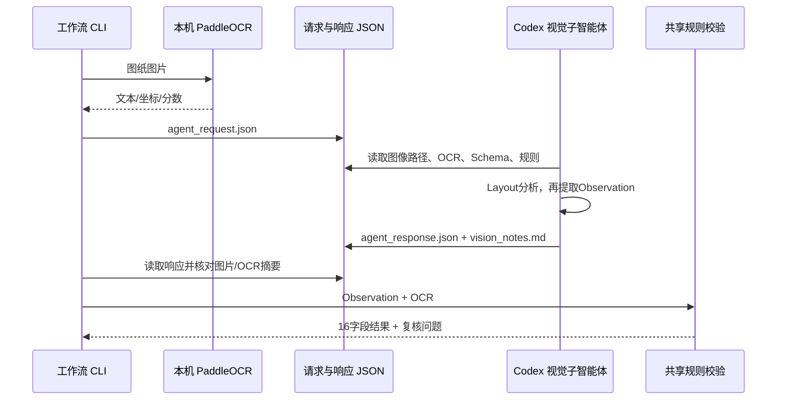

# 用 Codex 子智能体暂时代替豆包视觉节点

文件桥接允许外部视觉代理生成观察结果，主程序负责预处理、OCR、规则校验和导出。仓库附带一份历史样例响应，可离线回放。

## 实际接入方式



文件桥接是显式接口。应用不会在后台调用 Codex 内部 API，也没有伪造豆包返回。对子智能体的创建与任务分发由当前 Codex 会话执行，结果保存成应用可读取的数据。

## 请求

```powershell
python -m conduit --input data/examples/reference_drawing.png --ocr paddle-http --export-agent-request --out outputs/agent-handoff
```

也可使用已经保存的真实 OCR：

```powershell
python -m conduit --input data/examples/reference_drawing.png --ocr sidecar --ocr-json data/examples/reference_ocr_paddle.json --export-agent-request --out outputs/agent-handoff
```

请求包括整页与切片路径、OCR 行、知识材料、Layout 和 Observation 的 JSON Schema、识别规则及图纸/OCR 摘要。子智能体必须自己看实际图像，不能把人工转录 fixture 当成识别结果。

## 响应

```json
{
  "producer": "codex_subagent_drawing_vision_worker",
  "pages": [{
    "page_index": 1,
    "source_sha256": "从请求原样复制",
    "ocr_sha256": "从请求原样复制",
    "layout": {},
    "observation": {}
  }]
}
```

Layout 和 Observation 按 Schema 填写。Ref 的 value 必须逐字来自对应 OCR 行；没有文字证据时保留未知。图例、表格列、引线关系用视觉证据说明，可能误读的部分写入 notes。

图片摘要与 OCR 摘要不匹配时程序拒绝响应，避免把上一张图的分析意外用于本次图纸。

## 在统一工作流中使用

```powershell

python -m conduit --input data/examples/reference_drawing.png --ocr sidecar --ocr-json data/examples/reference_ocr_paddle.json --vision-backend agent-file --agent-response outputs/agent-handoff/agent_response.json --out outputs/reference-agent
```

审计模式为 `live_ocr_external_agent`，与 `fixture_replay` 或 `live_api` 区分。

参考样例可回放出 12 条记录；疑似电话平台、井类型和路段名称请结合导出的 audit.json 复核。交接目录由上述导出命令生成。

若重建输出目录，使用已归档的实际证据响应，无需重新调用模型：

```powershell
python -m conduit --input data/examples/reference_drawing.png --ocr sidecar --ocr-json data/examples/reference_ocr_paddle.json --vision-backend agent-file --agent-response data/examples/reference_agent_response.json --out outputs/reproduced-reference
```

这里仍是重用真实子智能体分析与实际 OCR，不是 mock。重新识别新图纸时必须导出新请求并由代理重新查看图片，不能套用这个样例响应。

agent-file 模式不会重新读取相同响应并假装进行模型修复，因此 `max_repairs` 被设为 0。发现问题后可由当前 Codex 会话向子智能体提供新的反馈、更新响应，再重新运行；也可以使用 LangGraph 的人工复核入口。真实 API 后端仍支持图内有限自动修复。

## 后续替换为豆包

有 API 后改成默认 `--vision-backend api` 并填写 `.env`。图像、OCR、Schema 和校验规则保持一致，模型节点换为 `ChatOpenAI` 兼容接口，可比较豆包与本次子智能体观察差异。比较时固定同一份真实 OCR 证据，避免把 OCR 差异误认为视觉模型差异。
