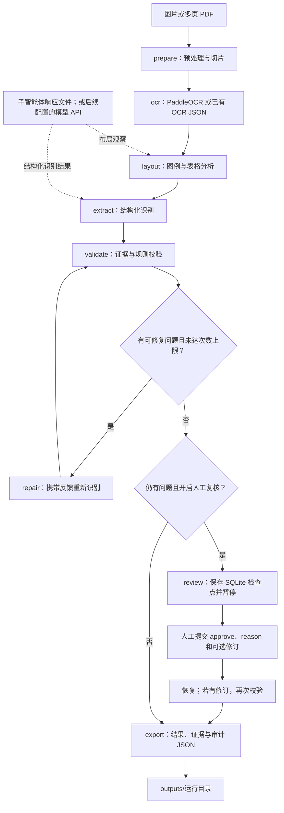

# 用管井图纸项目学习 LangChain 与 LangGraph

适用对象：了解 Python 函数、字典和基本类，第一次实现大模型工作流的人。代码使用 LangChain/LangGraph v1 风格；从仓库中的真实模块逐步理解，每节都能对应可运行内容。运行前请先按 [README](../README.md) 创建环境并安装项目。

## 1. 先理解这个项目到底要做什么

输入是一张通信管道平面图或多页 PDF，输出是每个可确认管井的 16 字段 JSON 记录。难点是图纸中同时存在文字、符号、引线、管线、表格、设备和图例。OCR 只能提供文字及坐标；视觉模型需要理解这些元素之间的关系；程序需要决定哪些字段可以输出。

原 Coze 项目是一个豆包 2.0 Pro 智能体加 PaddleOCR 插件。现在把职责拆到固定节点，才能看到哪一步出错、保存证据、决定是否重做，以及由人处理无法消除的歧义。

LangChain 提供模型、消息、提示模板、结构化输出及 Runnable 组合；LangGraph 用状态与节点控制分支、循环和暂停。两者可以一起使用：本项目状态图中的模型阶段由 LangChain 实现；只有一套正式工作流。[LangChain Models](https://docs.langchain.com/oss/python/langchain/models)、[LangGraph StateGraph](https://reference.langchain.com/python/langgraph/graph/state)。

## 2. 先运行，再读代码

项目现在只有一套正式实现。LangChain 负责模型、消息、提示词和结构化输出；LangGraph 负责整个识别流程的分支、修复和暂停恢复。学习时可以分别研究两者，实际运行用同一个入口。

```powershell
# 在克隆后的项目根目录执行
python .\scripts\run.py --mock --simulate-error --out outputs/demo
```

`--mock` 回放预置 OCR 和观察对象，不调用 PaddleOCR 或豆包。`--simulate-error` 故意生成一个无效桩号引用，工作流发现问题后重试。打开 `outputs/demo/results.json` 和 `audit.json`，观察最终字段和修复历史。

推荐按 `src/conduit/schema.py` → `rules.py` → `extract.py` → `service.py` → `workflow.py` → `cli.py` 的顺序阅读。所有正式 Python 代码集中在一个包；`scripts/run.py` 只是运行入口。

### 当前工作流示意图



图中的 `layout` 和 `extract` 节点使用 LangChain 模型组件，其余节点执行预处理、OCR、规则校验和导出；LangGraph 决定什么时候重做或暂停。可打开 [浏览器版流程图](workflow_diagrams.html) 查看完整图示。

没有豆包 API 时，先导出 `agent_request.json`，由子智能体读取图纸、OCR 和规则，再写入 `agent_response.json`。工作流通过图片与 OCR 摘要核对响应。文件模式把自动修复次数设为 0，已有响应不会被反复读取来冒充新的识别；配置模型 API 后，`repair` 节点可以直接重新调用模型。

项目统一使用 LangGraph 编排，入口为 `python -m conduit` 或 `scripts/run.py`。

## 3. 用 Pydantic 定义模型输出

先定义数据，再写提示词。否则模型能任意拼字段，后续节点容易因为漏字段或错误类型失败。

本项目有三个层次：`OCRLine` 是识别器结果，`Observation` 是模型观察，`Record` 是最终对外记录。内部字段用英文方便编码，导出字段用 Pydantic alias 保持原中文契约。

```python
from pydantic import BaseModel, Field

class Ref(BaseModel):
    text_id: str
    value: str

class ExampleRecord(BaseModel):
    name: str = Field(alias="管井名称")
    station: str = Field(alias="主线桩号")

record = ExampleRecord.model_validate({
    "管井名称": "电力手孔",
    "主线桩号": "K9+395",
})
print(record.model_dump(by_alias=True))
```

`model_validate` 检查结构，`model_dump(by_alias=True)` 切换到导出字段。它们不能判断桩号是否真的出现在图纸上；那属于业务规则，所以 `rules.py` 另做证据校验。

实际 `Record` 禁止额外字段，导出全部 16 项。没有适用的匝道桩号用空字符串，适用但看不清用“无法判断”。不要把二者统一改成 `None`，否则会丢失业务区别。

## 4. 从消息开始认识视觉模型

聊天模型接收一组消息。系统消息定义任务，用户消息提供待分析数据。图像应放到用户消息的内容块中，不能只给模型一个本地文件路径。

```python
from langchain_core.messages import HumanMessage
from conduit.io import image_data

message = HumanMessage(content=[
    {"type": "text", "text": "识别图例与编号表格的对应关系"},
    {"type": "image_url", "image_url": {
        "url": image_data("data/examples/reference_drawing.png"),
        "detail": "high",
    }},
])
```

`image_data` 读取图片并构造 PNG data URL。正式流程先把输入转为标准 PNG，因此类型一致。`make_messages` 还放入 OCR 行、切片在整页中的 bbox、布局观察和上轮反馈；内容块仍是列表。

整页帮助模型理解道路、图例与表格；局部切片保留小文字和细线。所有对象坐标统一为整页归一化坐标，避免把某切片的局部位置误当成整页位置。

## 5. ChatPromptTemplate 解决模板组合

提示模板让任务说明和运行数据分离。这里使用消息占位符，保留图片内容块。

```python
from langchain_core.prompts import ChatPromptTemplate

prompt = ChatPromptTemplate.from_messages([
    ("system", "{system}"),
    ("placeholder", "{drawing_messages}"),
])

prompt_value = prompt.invoke({
    "system": "分析通信管道图纸。所有桩号必须引用 OCR 证据。",
    "drawing_messages": [message],
})
```

把完整系统提示作为变量传入，也避免系统文本内的 JSON 花括号被误当作模板变量。源码 `structured_chain()` 使用这一方式。

提示词不是所有控制逻辑的容器。不要只写“必须再次检查分歧”然后假设模型已执行。程序中的连接去重、端点检查与分支规则，才提供可重复的核查行为。

## 6. 配置豆包模型接口

`.env` 管理本机配置，代码使用 `load_dotenv()` 读取。`ARK_API_KEY` 不写进代码、不导出到审计文件。`VISION_MODEL` 填你实际可用的豆包 2.0 Pro Model ID 或 Endpoint ID。

```python
import os
from dotenv import load_dotenv
from langchain_openai import ChatOpenAI

load_dotenv()
model = ChatOpenAI(
    model=os.environ["VISION_MODEL"],
    api_key=os.environ["ARK_API_KEY"],
    base_url=os.environ["OPENAI_BASE_URL"],
    timeout=120,
    max_retries=2,
)
```

火山方舟数据面 Base URL 为 `https://ark.cn-beijing.volces.com/api/v3`，接口采用 Bearer API Key 鉴权；应按账户实际可用模型填写 model。Coze 的模型选项和 API 配置是不同入口。[方舟 Base URL 与鉴权](https://docs.volcengine.com/docs/ark/base-url-and-authentication?lang=en)。

用户暂时无法获取豆包 API，因此本次另创建了 Codex 子智能体作为视觉节点，通过文件桥接读取实际图像/OCR并输出相同 Schema；运行方式见 `agent_bridge.md`。没有在缺少密钥时调用真实豆包，也没有代为申请接入点。以后配置就绪即可切回 API 后端。

## 7. with_structured_output 把回复变成对象

模型调用可以返回普通文本，也可以返回指定结构：

```python
from conduit.schema import Observation

structured_model = model.with_structured_output(
    Observation,
    method="function_calling",
    strict=False,
)
# 配置有效时执行：
# observation = structured_model.invoke(prompt_value)
```

`function_calling` 使用工具调用格式约束结果；`json_schema` 使用服务端结构化输出；`json_mode` 请求合法 JSON，代码另外把 Schema 加入提示并用 Pydantic 验证。选择实际接入点支持的方式，遇到 400 时先核对能力，不能把它当普通网络错误无限重试。方舟的结构化输出能力及支持范围应以当前官方说明为准。[方舟结构化输出](https://docs.volcengine.com/docs/ark/structured-output-beta?lang=zh)。

这些方式保证或检查的是结构。一个合法的 `K999+999` 仍可能是捏造桩号。这个项目通过 `Ref.text_id` 和 `Ref.value` 去对照 OCR 文本，再把缺证据字段降级。

## 8. RunnableLambda 与模型阶段的 LCEL

Runnable 是能接收输入、产生输出的组件，常用入口是 `.invoke()`。`RunnableLambda` 把普通 Python 函数包装成 Runnable，LCEL 的 `|` 把上一步输出传给下一步。

```python
from langchain_core.runnables import RunnableLambda

normalize = RunnableLambda(lambda x: x.strip())
identify = RunnableLambda(lambda x: {"原始标注": x, "包含手孔": "手孔" in x})
example = normalize | identify
print(example.invoke("  桥头电力手孔  "))
```

当前项目在 `extract.py` 的 `structured_chain()` 中使用 LCEL，连接“整理图像与 OCR 消息→格式化提示词→调用结构化模型”，并对输出结构错误做有限重试。`layout()` 和 `extract()` 分别调用这样的模型链。

整个图纸任务由 `workflow.py` 的 `build_graph()` 管理。模型阶段的链作为图节点的一部分，因此 LangChain 与 LangGraph 共存在一套代码中。

## 9. OCR 是普通工具函数，也可以成为节点

Coze 中 OCR 是插件；在 Python 中可以把它视为确定输入输出契约的函数。这里 `OCRProvider.read(page, settings)` 返回 `list[OCRLine]`。无需让模型自行决定是否调用 OCR，因为这个项目每页必须有独立文字证据。

四种适配：

| 模式 | 使用场景 |
|---|---|
| paddle-http | 主 Python 3.14 环境调用独立 Python 3.12 的 OCR 服务 |
| paddle | 在已安装 PaddleOCR 的兼容环境中直接推理 |
| sidecar | 使用已保存的 OCR JSON，便于复现和省去重复推理 |
| tesseract | 可选替代，需要单独安装可执行文件与语言包 |

PaddleOCR 3.x 的预测结果包含识别文本、分数和坐标，本项目转换为页内唯一 ID、文本、归一化 bbox、confidence。具体部署与实际结果见 `paddleocr_deployment.md`。[PaddleOCR Python 产线接口](https://github.com/PaddlePaddle/PaddleOCR/blob/main/docs/version3.x/pipeline_usage/OCR.md)。

只有“文字存在”还不够。例如 OCR 同时读到 34# 和 K9+043，但两者的关系需要表格列和虚线支持。模型在 layout 节点先分析对应形式，extract 节点引用文字并给出关联说明。

## 10. 业务校验决定能否落库

`validate_page()` 接收观察对象和当前页 OCR，返回记录及问题列表：

```python
from conduit.io import load_json
from conduit.rules import validate_page

page = load_json("data/examples/demo_scene.json")["pages"][0]
records, issues = validate_page(page["observation"], page["ocr"], page_index=1)
print(records[0]["主线桩号"])
print([issue["code"] for issue in issues])
```

关键检查包括：

- 名称来自完整 OCR 标注；组内从左到右编号，组间重新开始。
- 每条桩号引用实际存在，值符合格式，有对应关系说明；不存在则“无法判断”。
- 距离必须来自带实际单位的尺寸文字和尺寸端点说明；毫米可换算为米。
- 井间连接端点必须属于已确认井；同一条边重复不能增加邻井数量。
- 沿主线连接前后两个井仍可直通；分歧需要局部支路和足够独立邻井。
- 邻近设备标记疑似且不继承井桩号；明确引线或明确文本关联可继承。
- 空记录页、截断、共享专号和其他歧义进入复核列表。

这类规则应该用单元测试覆盖，因为写错会批量污染结果。项目测试验证的是这些业务失败情形，不是把每一行代码照搬成测试。

## 11. LangGraph 的 State 是工作流记忆

状态字典包含 settings、pages、ocr_pages、layouts、observations、records、issues、attempts、history、review_decision、artifacts。这里主要是可以持久化的普通字典和列表，没有把带网络连接的客户端对象放进状态。

```python
from typing import TypedDict

class SmallState(TypedDict, total=False):
    ocr_pages: list
    observations: list
    issues: list
    attempts: int
```

节点接收完整当前状态，返回字段更新。LangGraph 合并更新，节点不用每次复制整个字典。本项目使用默认覆盖语义：新一轮 observations/records/issues 替换旧值；history 由 validate 节点显式追加。

如果以后让多个页面节点并行写入同一列表，需加 reducer 或按页映射，避免并行更新冲突。当前按页顺序处理，易于调试和控制调用量。

## 12. 节点、边与条件路由

```python
from langgraph.graph import StateGraph, START, END

builder = StateGraph(SmallState)
builder.add_node("ocr", lambda state: {"ocr_pages": []})
builder.add_node("extract", lambda state: {"observations": []})
builder.add_edge(START, "ocr")
builder.add_edge("ocr", "extract")
builder.add_edge("extract", END)
small_graph = builder.compile()
print(small_graph.invoke({}))
```

项目再加条件路由：

```python
def route(state):
    if any(x["repairable"] for x in state["issues"]) and state["attempts"] < state["settings"]["max_repairs"]:
        return "repair"
    if state["issues"] and state["settings"]["human_review"]:
        return "review"
    return "export"
```

`repair` 增加计数，只重做涉及可修复问题的页面，然后回到 validate。修复没有新证据时保留未知字段，到上限后进入人工复核或输出保守结果。

区分三种错误：网络错误由模型客户端有限重试；输出结构错误由 `.with_retry()` 重试；业务错误由图中的 repair 节点处理。鉴权失败或服务端不支持接口不应该进入业务修复。

## 13. 人工复核不是 input()，而是 interrupt()

命令行 `input()` 会绑住运行进程。LangGraph 的 `interrupt()` 配合 checkpointer 保存状态，外部应用可以稍后提交决策恢复。恢复必须使用相同的 `thread_id` 和 `Command(resume=...)`。[LangGraph Interrupts](https://docs.langchain.com/oss/python/langgraph/interrupts)。

```python
from langgraph.types import interrupt

def review(state):
    decision = interrupt({
        "records": state["records"],
        "issues": state["issues"],
    })
    return {"review_decision": decision}
```

中断恢复会从节点开始重新执行，所以不要在 interrupt 之前写数据库、发送消息或收费调用模型。本项目 review 节点在中断前只构造复核材料。

`approve=true` 表示人工允许保守结果导出，不能解释成每个字段均已确定。审计仍保留问题。人工提交修订 observations 后也要再次通过引用校验。

## 14. SQLite 检查点与进程重启

```python
from langgraph.checkpoint.sqlite import SqliteSaver
from langgraph.types import Command
from conduit.workflow import build_graph

config = {"configurable": {"thread_id": "drawing-review-001"}}
with SqliteSaver.from_conn_string("runtime/checkpoints/checkpoints.sqlite") as saver:
    graph = build_graph(checkpointer=saver)
    # 首次执行：graph.invoke(initial_state, config)
    # 人工确认后：
    # graph.invoke(Command(resume={"approve": True, "reason": "已核对"}), config)
```

SQLite 文件让中断状态跨进程存活；只有 `InMemorySaver` 则仅在当前进程存活。CLI 对已存在 thread_id 拒绝新建覆盖，恢复时加载原状态中的设置。[LangGraph Persistence](https://docs.langchain.com/oss/python/langgraph/persistence)。

检查点保存的是流程数据与文件路径，不能代替图纸/切片文件备份。复核期间保留输入图片、当前运行输出目录中的 `pages/` 和知识材料，模型修复可能还需要它们。

## 15. 如何把 Coze 知识库加入

目前 `load_knowledge()` 读取目录下的 Markdown，保留 source 文件名。材料总长度超过 24000 字符时报错，避免静默截断后误以为所有规则已生效。

这对少量图例说明和规则材料够用。若原库规模更大，可扩展为：文档整理 → 按规则或图例切块 → 建索引 → 根据 layout 检索 → 把相关片段及图例图加入 extract。检索片段提供判别方法，当前图纸中的桩号和距离仍必须来自当前页面证据。

当前没有向量库、没有 embeddings 调用，也未读取 Coze 内部知识库。不要把已有两份 Markdown 说明包装成完整 RAG 系统。

## 16. 用你的真实样例做一次实验

此次已实际部署 PaddleOCR 并由 Codex 子智能体代替豆包；先按 `agent_bridge.md` 的无 API 命令查看本次结果。下面的命令用于后续取得豆包 API 后直接调用模型。

确保 OCR 服务启动，`.env` 填好豆包配置：

```powershell
& .\scripts\start_ocr.ps1
python -m conduit --input data/examples/reference_drawing.png --ocr paddle-http --human-review --out outputs/live
```

如果服务已启动，不必重复执行 start 脚本。先观察 OCR JSON：12 列是否被分开、K9+285 等桩号是否误读、类型行是否错位。再检查 evidence 中井的 bbox 和 station_evidence，最后核对最终 JSON。

若 OCR 文字错误，重跑相同模型提取不能凭空修好它。可提高 OCR 输入分辨率或对表格区域单独重 OCR，然后把新文字及新坐标作为独立证据接入。当前 repair 节点只重识别相关页的模型观察，不会自动改写 OCR 文字。

## 17. 如何评价下一步改进

建立人工标注集时，把每个真实符号、名称组、编号列、桩号、管线和设备连接分别标注。样例人工回放不是最终标准答案，尤其 38# 附近结构需专业复核。

建议按对象召回率、误检率、桩号完全匹配率、关系准确率、未知字段比例、复核比例、耗时与调用量分别比较。不能只看“JSON 是否合法”，也不能把模型 confidence 平均值称作准确率。

优先扩展：表格单元格 OCR、局部重 OCR、复核界面上的证据框、跨页边匹配、按页缓存及服务化任务队列。真实并发部署再换数据库检查点、独立输出目录和受控模型访问。

完成本教程后，你应能修改 Pydantic Schema、增加一条业务校验、把一个函数接入 LCEL、添加一个图节点，并解释某条 JSON 字段的证据来源。
