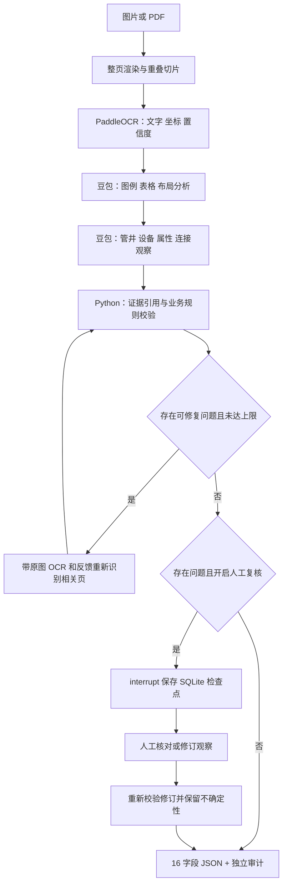

# 从 Coze 单智能体到图纸识别工作流

## 已知原项目与新实现

用户确认原项目为 Coze 单智能体，模型是豆包 2.0 Pro，只有一个 PaddleOCR 插件，没有可导出的工作流。原提示词见 [data/examples/original_prompt.md](../data/examples/original_prompt.md)。实现依据可见提示词与样例；不包含 Coze 内部知识库、隐藏参数或插件接口。

新实现保留视觉模型与 OCR 的职责，增加两个模型阶段、程序校验、审计材料、有限修复及人工复核。



项目只保留上图这一套工作流。LangChain 组织两个模型阶段的消息、提示词及结构化输出，LangGraph 控制节点顺序、修复、复核与恢复。

## 节点契约

| 节点 | 输入 | 输出 | 职责 |
|---|---|---|---|
| prepare | settings | pages | EXIF 方向、PDF 渲染、整页与原分辨率切片 |
| ocr | pages | ocr_pages | 独立识别文字，给每行分配 ID 和整页坐标 |
| layout | 页面 + OCR + 规则材料 | layouts | 判断文字引线型/表格对应型/混合型，分析图例和表格列 |
| extract | 原图 + OCR + layout | observations | 识别井/设备符号及局部关联，所有文字属性用 Ref 引用 |
| validate | observations + OCR | records + issues + history | 强制字段、核对桩号/尺寸、命名组、连接、复核问题 |
| repair | 指定问题 + 原观察 | 新 observations | 只重新识别有可修复问题的页面，更新 attempts |
| review | records + issues + observations | 人工决策/修订 | 通过 interrupt 暂停，恢复时再验证人工输入 |
| export | records + evidence + audit | 文件路径 | 单独导出 JSON 数组、证据、审计 |

## 为什么保留中间对象

直接让模型输出 16 个字段会丢失“这个值从哪里来”的信息。当前 `Well` 记录真实符号坐标、完整 OCR 名称标注、名称组、桩号文本引用及引线说明。`Device` 独立保存，`Edge` 用对象 ID 记录关系，最终设备字段由程序按同一顺序用“；”连接。

例如内部桩号：

```json
{"text_id": "s38", "value": "K9+395"}
```

校验器先确认本页确实存在 OCR 行 `s38`、其文字包含 `K9+395`，再检查桩号格式和对象对应证据是否非空。没有证据时输出“无法判断”并留备注。坐标、关系说明来自模型，仍需人工验证其真实性；这个机制能拦截无来源值，不能保证视觉关联永远正确。

## 真实样例的难点

样例为管道平面布设图，右上页号 17；上方道路有 34#～45# 编号，底部表格包含编号、中心桩号、类型和用途。参考过程：

1. 从上部实际井符号找到编号。
2. 沿虚线/引线确认其在下表对应哪一列。
3. 读取该列桩号，不能只按最近文字寻找。
4. 表格内“中墩两侧”“开口两侧”属于位置语义，结合图例判别实体类型。
5. 38# 附近圆形、竖向结构、两个方框与“紧急电话”用途需要复核，不能把方框一律视为手孔。

`reference_scene.json` 是人工转录的暂定示例。它能验证表格对应数据如何流转，不能作为自动识别准确率或完整对象数量的标准答案。

## 原提示词冲突的处理

| 冲突/歧义 | 当前决策 |
|---|---|
| 前文允许分歧/直通、纯桩号图例井；后文只允许三类关键词 | 默认广义范围；`--strict-names` 选择后文严格范围 |
| 原名称必须完整；一标多井示例又要求去掉数量并加序号 | 中间证据保留完整原名，导出对多符号组按示例去数量后缀并编号 |
| 两个邻井既可能是直通也可能分歧 | 沿主线前后贯通保留直通；局部有支路且两个以上不同已记录井才判分歧 |
| 名称明确为分歧但连线不清 | 名称优先保留分歧，同时输出复核问题，不伪造连接 |
| OCR 错误与视觉文字冲突 | 当前高风险字段优先可核对 OCR；模糊/缺字降级，后续可用局部重 OCR 增补独立证据 |
| 设备桩号需继承但关联多个不同桩号井 | 不任选桩号，保留无法判断并记录冲突 |

一处专号关联多个井时保留多个符号记录并备注；无法确定是否真有多个符号时不会凭编号数量增造对象。跨页连接仅标记缺失，当前不自动拼接全线路网。

## 知识库的边界

`data/knowledge/` 目前有依据用户提示词整理的规则和依据样例整理的表格识别方法，作为独立数据材料注入两个模型阶段。它是小规模全文上下文，不是向量 RAG，也没有伪称来自 Coze 导出。

待拿到原知识库文件，可整理为 Markdown 放入该目录。图例图片最好同时加入每页视觉上下文；仅用文本嵌入无法表达细线连通和符号差异。大规模材料应另加检索节点，保留文档来源、页码、图例图片与检索分数，再把相关内容传入模型。
